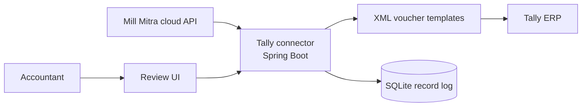

# Mill Mitra Tally Connector

**Local sync agent that turns ERP purchases and sales into Tally vouchers.**

  

> [!NOTE]
> **Showcase repository.** This is client work built at Runtime Solutions, and its source code is private. This page documents the product, my role and the engineering behind it.

## Overview

Accountants at the mill work in Tally ERP. This connector runs on their machine, receives purchase and sales data from Mill Mitra, generates Tally-compatible XML vouchers, and pushes them into Tally, while keeping a local record of every attempt so nothing is lost or duplicated.

## My role

**Backend developer**: about 80 commits covering voucher generation, ledger sync and the review UI.

## Tech stack

| Layer | Technologies |
|---|---|
| Backend | Java, Spring Boot, Thymeleaf |
| Storage | SQLite (local record store) |
| Integration | Tally ERP XML over HTTP, TDL scripts |

## Architecture

## What I built

- **Purchase and sales vouchers**: XML templates with claims, deductions, wheat rate differences, retention amounts, GSTIN, pincode and address fields.
- **Ledger sync and daybook retrieval** over Tally's XML interface, with XML-to-JSON conversion for the cloud side.
- **Review UI**: paginated voucher lists, detail modals, push-to-Tally actions, XML viewing and status handling for rejected records.
- **GST and state lookups** used while building vouchers.

---

**Priyansu Chowdhury**: Backend-leaning full-stack developer (Java / Spring Boot · Next.js / TypeScript)

[LinkedIn](https://linkedin.com/in/priyansu-chowdhury) · [GitHub](https://github.com/Pr1yansu)

